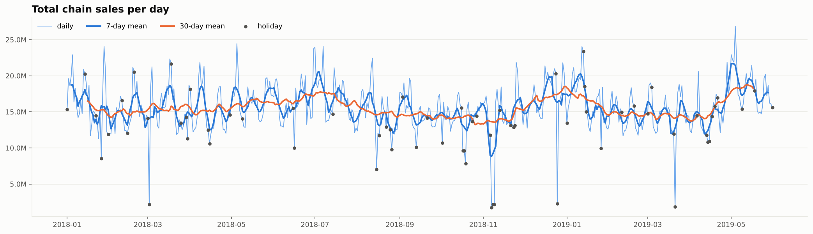
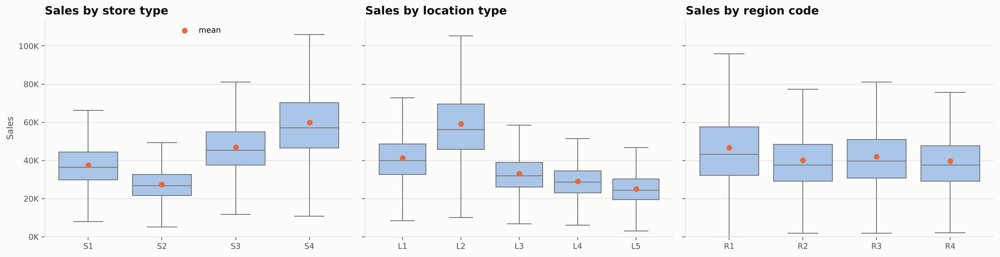
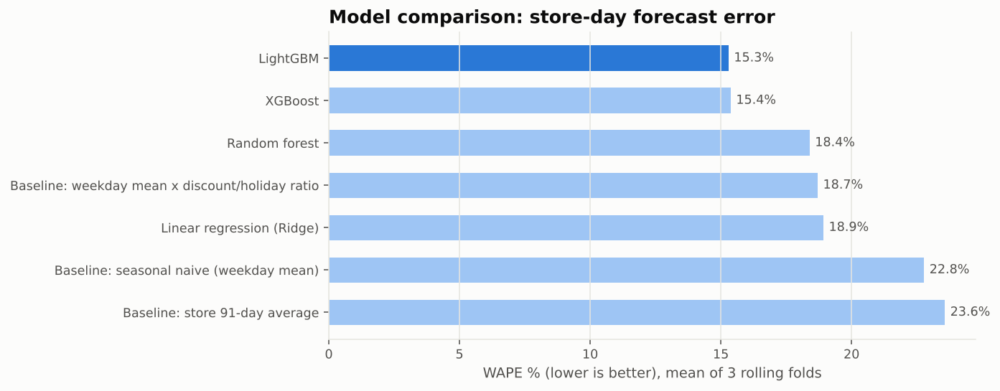
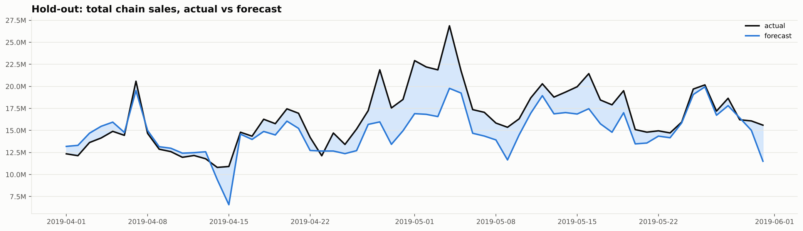
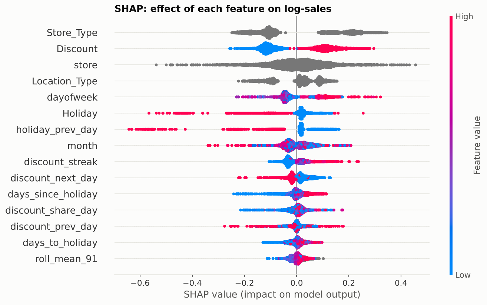
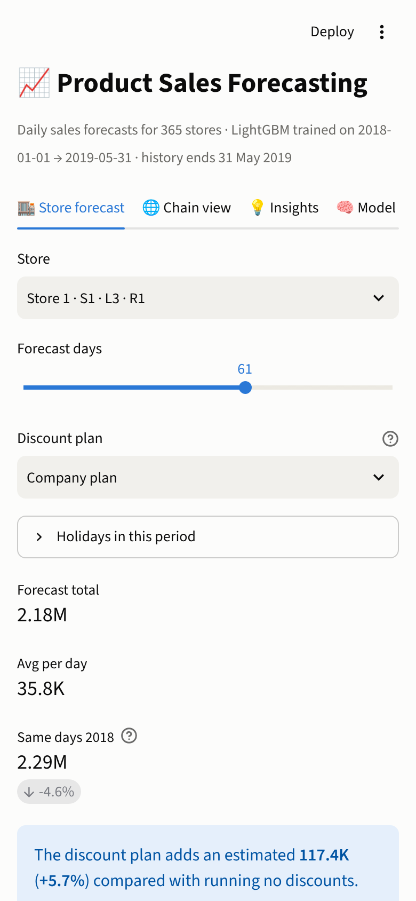
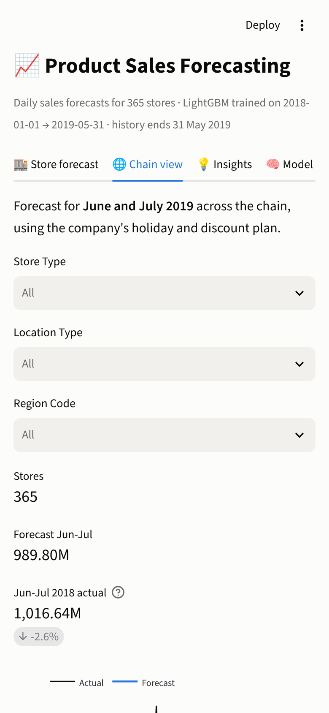
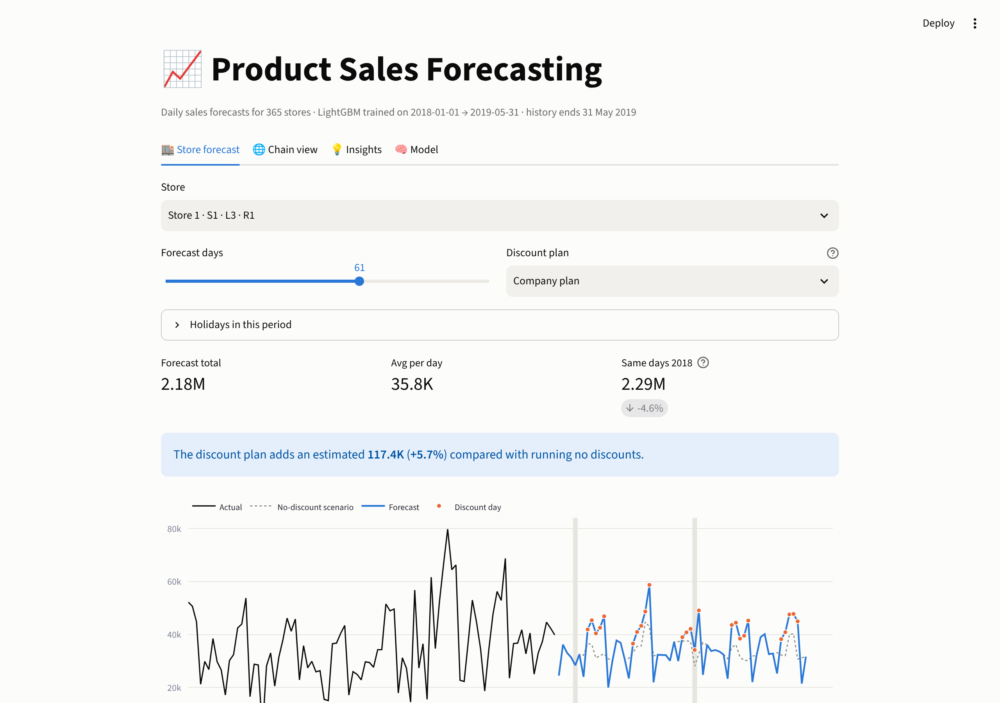

# 📈 Product Sales Forecasting

**Forecasting daily sales for 365 retail stores, 61 days ahead, with a global LightGBM model, deployed as a mobile-friendly web app and a REST API.**

[](https://sales-forecasting-hpg.streamlit.app)


| | |
|---|---|
| 🚀 **Live app** | [sales-forecasting-hpg.streamlit.app](https://sales-forecasting-hpg.streamlit.app) (works on mobile) |
| 📓 **Notebook** | [`notebooks/Product_Sales_Forecasting.ipynb`](notebooks/Product_Sales_Forecasting.ipynb): EDA, hypothesis tests, modelling, insights |
| 🔌 **REST API** | [`api/app.py`](api/app.py) (Flask) |
| 📊 **Tableau data** | [`data/processed/`](data/processed/) (see [data guide](data/processed/README.md)) |

---

## 1. Problem statement

A retail chain with **365 stores** (4 store types, 5 location types, 4 regions) needs a forecast of **daily sales per store for the next two months** (1 June to 31 July 2019). Accurate forecasts drive:

* **Inventory**: the right stock per store, fewer stock-outs and less over-stock
* **Finance**: realistic revenue targets and budgets
* **Marketing**: knowing when and where discount campaigns pay off
* **Operations**: staffing and supply-chain scheduling around demand peaks

**Data:** `TRAIN.csv` has 188,340 rows (365 stores × 516 days, 1 Jan 2018 to 31 May 2019) with store attributes, a holiday flag, a discount flag, the number of orders and **sales (the target)**. `TEST_FINAL.csv` has 22,265 rows for June and July 2019 with the holiday and discount plan, but no orders or sales.

**Target metric:** **WAPE** (weighted absolute percentage error = Σ|error| / Σ sales), chosen as the primary business metric because it reads as "% of sales we get wrong" and is not distorted by small days. MAE, RMSE, MAPE and R² are reported too.

---

## 2. Approach

```
Raw CSVs ─► Data quality ─► EDA ─► Hypothesis tests ─► Feature engineering ─► Rolling-origin CV
                                                                                    │
            Streamlit app ◄── Flask API ◄── Final LightGBM ◄── Tuning ◄── 10 models compared
```

### 2.1 Data quality
* No missing values, no duplicates, and a complete store × date grid. Store attributes never change, and holidays are one chain-wide calendar.
* **19 zero-sales rows** (all with zero orders, in runs of 2 to 3 days) are **store closures**. They are excluded from training and from MAPE.
* 3.1% of rows are high outliers by the IQR rule, and 73% of them are discount days: they are **real promotion peaks, so they are kept**. The model uses log-sales to limit their leverage.

### 2.2 Exploratory data analysis: key findings

| Finding | Number |
|---|---|
| Discount days sell more | **+32%** on average (+33.5% per store, 364 of 365 stores) |
| Holidays sell less | **−19%**; **−48%** on the second and later days of multi-day holidays |
| Weekends are the peak | Sunday **+15%**, Saturday **+9%**; Friday is the weakest day (−7%) |
| Format and location set the level | S4 59.9K/day vs S2 27.5K; L2 59.2K vs L5 25.2K |
| Region matters little | 39.7K to 46.8K per day |
| No long-term trend | Stationary (ADF p = 0.007); seasonal highs in January, May, July and December; **May 2019 was a record month (+10% YoY)** |
| Discounts are chain-wide campaigns | On 49% of days, either more than 90% or fewer than 10% of stores are on discount |
| Orders mirror sales | r = **0.94**. S4 has the *lowest* basket value, so its sales come from more orders |

<p align="center"></p>
<p align="center"></p>

### 2.3 Hypothesis testing (α = 0.05)
Every test reports an **effect size** next to the p-value (with 188k rows almost everything is "significant"). The main tests are repeated on **store-level means** to avoid pseudo-replication, and each parametric test is paired with a non-parametric one.

| # | Hypothesis | Tests | Result |
|---|---|---|---|
| H1 | Discounts affect sales | Welch t, Mann-Whitney U, paired t, Wilcoxon | **Reject H0**: +33.5% per store, Cohen's d = 0.69 |
| H2 | Holidays affect sales | same | **Reject H0**: −19.1% per store, every store |
| H3 | Store type affects sales | ANOVA, Welch ANOVA, Kruskal-Wallis, Tukey HSD | **Reject H0**: η² = 0.72 between stores, all pairs differ |
| H4 | Location type affects sales | same | **Reject H0**: η² = 0.70, 8 of 10 pairs differ |
| H5 | Region affects sales | same | **Reject H0, small effect**: η² = 0.03 |
| H6 | Weekends sell more | Welch t, Mann-Whitney U, paired t, Wilcoxon | **Reject H0**: +17.5% per store |
| H7 | Orders correlate with sales | Pearson, Spearman | **Reject H0**: r = 0.94 |
| H8 | The discount effect differs by segment | Two-way ANOVA (log sales) | **Reject H0, negligible**: uplift is 30 to 34% everywhere |

Full table: [`data/processed/hypothesis_results.csv`](data/processed/hypothesis_results.csv)

### 2.4 Feature engineering: no leakage
Only information known **on the day the forecast is made** is allowed:

| Group | Features |
|---|---|
| Plan inputs | `Holiday`, `Discount` |
| Store identity | store id (categorical), store type, location type, region |
| Calendar | weekday, weekend, month, start and end of month |
| Holiday proximity | days since and until a holiday, holiday yesterday and tomorrow |
| Campaign context | discount yesterday and tomorrow, consecutive discount days, share of stores on discount that day |
| Store level | rolling 7, 28 and 91-day mean of log-sales, **shifted by 61 days** |

`#Order` is **excluded**: it is 0.94-correlated with sales but only known after the day ends, so using it would be target leakage.

### 2.5 Validation
**Rolling-origin cross-validation** with three folds, each forecasting **61 days** (the real horizon): Dec–Jan, Feb–Mar and Apr–May. A random split would leak the future into the past.

### 2.6 Models compared (mean of 3 folds)

| Model | WAPE % | MAPE % | RMSE | R² |
|---|---|---|---|---|
| Baseline: store 91-day average | 23.6 | 31.0 | 14,486 | 0.44 |
| Baseline: seasonal naive (weekday mean) | 22.8 | 30.5 | 13,894 | 0.49 |
| Baseline: weekday mean × discount/holiday ratio | 18.7 | 23.6 | 11,887 | 0.62 |
| Linear regression (Ridge) | 18.9 | 22.4 | 11,849 | 0.63 |
| Random forest | 18.4 | 20.8 | 11,644 | 0.64 |
| XGBoost | 15.4 | 17.4 | 10,060 | 0.73 |
| **LightGBM (selected)** | **15.3** | **17.4** | **10,008** | **0.73** |

**Chain-level comparison** (total sales per day, mean of 3 folds): **LightGBM summed over stores 10.4% WAPE**, SARIMAX with discount and holiday regressors 14.2%, Prophet with regressors 17.2%, Holt-Winters 18.1%.

**Ablations:** adding raw lags and day-of-year *worsens* WAPE to 15.9%. Removing the store id raises it to 18.6%, and removing the campaign features raises it to 18.1%.
**Tuning:** a random search over 8 configurations did not beat the defaults (range 15.4 to 15.8%), so the defaults were kept.
**LSTM:** not used. With 516 days per store and event-driven demand, boosted trees are the stronger and cheaper choice (see the notebook for the reasoning).

<p align="center"></p>

---

## 3. Final results

The final model was trained on data up to 31 March 2019 and evaluated on **1 April to 31 May 2019**, forecast 61 days ahead through the same code path the app uses.

| Level | WAPE | MAPE | R² |
|---|---|---|---|
| Store × day | **16.8%** | 15.6% | 0.67 |
| Store × week | 13.2% | 11.5% | 0.73 |
| **Store × 61-day total** | **10.5%** | 9.9% | **0.83** |
| Chain × day | 11.6% | 11.0% | 0.42 |

* For store-month planning the forecast is **about 90% accurate**. Errors are even across store types, locations and regions (14 to 18%).
* The hold-out under-forecasts by 9.8% because **May 2019 was a record month**. Earlier folds showed biases from −10.5% to +4.5%, so this is not a fixed offset. The fix is to **retrain monthly**.
* **Forecast for June and July 2019: 989.8M** in total, 2.6% below the same months of 2018 ([`test_forecast.csv`](data/processed/test_forecast.csv)).

<p align="center"></p>
<p align="center"></p>

---

## 4. Insights and recommendations

| Area | Recommendation |
|---|---|
| **Promotions** | Discounts lift sales by about 33% in almost every store. Schedule campaigns on **weaker days (Tuesday to Friday) and months (February, November)**, and measure each campaign against the model's no-discount scenario (built into the app). |
| **Pre-campaign dip** | Many stores lose sales on the day before a campaign starts, as customers wait. Announce campaigns on the start day, or keep teasers short. |
| **Holidays** | Cut staff and fresh stock on holidays (−19%), especially from the **second day of multi-day holidays (−48%)**. |
| **Weekends** | Staff up and replenish before Saturday and Sunday (+17.5% per store). |
| **Inventory** | Plan at store-week or store-month level (87 to 90% accurate). Keep about a 17% buffer for single days with high stock-out costs. |
| **Network** | Prioritise **S4 and S3 formats in L2 and L1 locations**. Review S2 and L5 stores, which sell less than half as much per day. |
| **Process** | Retrain monthly, monitor bias, and retrain early if it exceeds ±5%. |
| **Data** | Record discount depth (%), prices, footfall and local events to sharpen campaign planning. |

---

## 5. Deployment

### 5.1 Streamlit web app (mobile-friendly)
[`streamlit_app.py`](streamlit_app.py) has four tabs:
* **Store forecast**: pick a store, a horizon (7 to 120 days) and a discount plan (company plan, none, weekends, every day), and add holidays. It shows the forecast chart, totals versus last year, the **estimated uplift from the discount plan**, a daily table and a CSV download.
* **Chain view**: the June and July 2019 forecast for the whole chain, filterable by store type, location and region, with segment breakdowns and the top stores.
* **Insights**: the key EDA effects.
* **Model**: hold-out accuracy, feature importance and how the model works.

<p align="center">
  
  
</p>
<p align="center"></p>

**Deploy on Streamlit Community Cloud (free, can be done from a phone):**
1. Go to [share.streamlit.io](https://share.streamlit.io) and sign in with GitHub.
2. Tap **Create app**, then **Deploy a public app from GitHub**.
3. Repository `dot-hpg/sales-forecasting`, branch `main`, main file `streamlit_app.py`.
4. Optional: set the App URL to `sales-forecasting-hpg`, so the link in this README works.
5. **Advanced settings**: Python 3.12. Then tap **Deploy**. The first build takes about 3 to 5 minutes.

**Run locally**
```bash
git clone https://github.com/dot-hpg/sales-forecasting.git && cd sales-forecasting
python -m venv .venv && source .venv/bin/activate      # Windows: .venv\Scripts\activate
pip install -r requirements.txt
streamlit run streamlit_app.py
```

### 5.2 Flask REST API
```bash
python api/app.py                       # development server on http://localhost:5000
gunicorn --chdir api app:app            # production
docker build -t sales-api . && docker run -p 8000:8000 sales-api
```
It can also be deployed for free on **Render**: New, then Blueprint, then pick this repo (uses [`render.yaml`](render.yaml)).

| Endpoint | Description |
|---|---|
| `GET /health` | Status, training period, hold-out WAPE |
| `GET /stores` | All 365 stores with attributes |
| `POST /predict` | Forecast one row, a list of rows, or `{"rows": [...]}` |

```bash
curl -X POST http://localhost:5000/predict -H "Content-Type: application/json" \
     -d '[{"store_id": 1, "date": "2019-06-08", "holiday": 0, "discount": "Yes"},
          {"store_id": 1, "date": "2019-06-09", "holiday": 0, "discount": "No"}]'
```
```json
{"count": 2,
 "predictions": [{"store_id": 1, "date": "2019-06-08", "holiday": 0, "discount": 1, "predicted_sales": 61449.55},
                 {"store_id": 1, "date": "2019-06-09", "holiday": 0, "discount": 0, "predicted_sales": 25811.96}],
 "total_predicted_sales": 87261.51}
```
Dates can be up to 366 days after the end of the history (31 May 2019). Days between the end of the history and the requested dates are assumed to have no holiday and no discount unless you include them. Forecasts beyond 61 days are made recursively in 61-day blocks. Invalid input returns HTTP 400 with a clear message.

### 5.3 Reproduce everything
```bash
pip install -r requirements-dev.txt
python scripts/train.py          # trains the model, writes models/ and data/processed/
jupyter lab notebooks/           # the full analysis
pytest -q                        # 13 tests: features, leakage guard, model, API
```

---

## 6. Repository structure
```
├── streamlit_app.py            # mobile-friendly web app (Streamlit Cloud entry point)
├── api/app.py                  # Flask REST API
├── forecasting/                # shared package: features, model, metrics, chart style
├── scripts/train.py            # training pipeline and exports
├── notebooks/Product_Sales_Forecasting.ipynb
├── models/                     # trained model and metadata (metrics, feature importance)
├── data/raw/                   # TRAIN.csv, TEST_FINAL.csv
├── data/processed/             # clean data, forecasts, model and test results (Tableau-ready)
├── reports/figures/            # all notebook charts (PNG)
├── tests/                      # pytest suite
├── Dockerfile, render.yaml     # API deployment
└── requirements.txt, requirements-dev.txt
```

## 7. Tech stack
Python · pandas · NumPy · SciPy · statsmodels · scikit-learn · LightGBM · XGBoost · Prophet · SHAP · Matplotlib · Seaborn · Plotly · Streamlit · Flask · gunicorn · Docker · pytest

---
**Author:** Guntuku Hariprasad · [GitHub @dot-hpg](https://github.com/dot-hpg)
