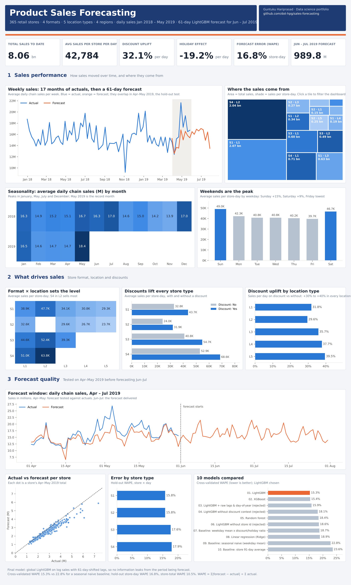

# Tableau Public dashboard

| File | What it is |
|---|---|
| [`Sales_Forecasting_Dashboard.twbx`](Sales_Forecasting_Dashboard.twbx) | Packaged workbook: the dashboard, its 13 views and the data. Open it and publish |
| [`Sales_Forecasting_Starter.twbx`](Sales_Forecasting_Starter.twbx) | Fallback: the same data, all calculated fields and colours, and one chart, for building the rest by hand |
| [`tableau_sales.csv`](tableau_sales.csv) | The single data source: 232,870 rows of store × day actuals, hold-out forecasts and the Jun–Jul 2019 forecast |
| [`tableau_models.csv`](tableau_models.csv) | Model leaderboard (cross-validated WAPE of all 10 models) |
| [`dashboard_preview.png`](dashboard_preview.png) | Static render of the same design, from the same CSVs |

All of them are rebuilt by `python scripts/build_tableau.py && python scripts/render_tableau_preview.py`.
The workbooks are written in the Tableau 2021.2 file format, which any later Tableau Public opens and upgrades.

---

## Publish it (about 5 minutes, on a laptop)

Tableau Public's editor is a desktop app, so this part needs a Windows or Mac computer.

1. Install **Tableau Public** (free) from [public.tableau.com/app/discover/download](https://public.tableau.com/app/discover/download) and sign in or create a free profile.
2. Download [`Sales_Forecasting_Dashboard.twbx`](https://github.com/dot-hpg/sales-forecasting/raw/main/tableau/Sales_Forecasting_Dashboard.twbx) and double-click it. The dashboard opens.
3. **File → Save to Tableau Public As…**, name it `Product Sales Forecasting`, then **Save**. Your browser opens the published dashboard.
4. On that page, click **Share** and copy the link. Done.

Optional polish (2 minutes, before step 3):
* **Filters:** on the dashboard, click the *Sales Trend* view, open its ▾ menu → **Filters → Store_Type**. Then on the new filter card ▾ → **Apply to Worksheets → All Using This Data Source**. Repeat for **Region_Code**.
* **Phone layout:** **Dashboard → Device Preview → Phone → Add Phone Layout**. Tableau stacks the cards automatically.

---

## The dashboard

One page, 1300 × 2260 px, top to bottom:

| Section | View | Built from |
|---|---|---|
| Header | Title band | Text |
| KPI tiles | Total sales 8.06 bn · Discount uplift +32.1% · Holiday effect −19.2% · Hold-out WAPE 16.8% · Jun–Jul forecast 989.8 M | `Total Sales (bn)`, `Discount Uplift`, `Holiday Effect`, `Hold-out WAPE`, `Jun-Jul Forecast (M)` |
| Trend | Weekly line of average daily chain sales, actual (blue) vs forecast (orange) | `Avg Daily Chain Sales` by `WEEK(Date)`, colour `Series` |
| Segments | Heatmap of store type × location type | `AVG(Actual Sales)` |
| Segments | Discount vs no discount by store type | `AVG(Actual Sales)`, colour `Discount` |
| Calendar | Average sales by weekday | `AVG(Actual Sales)` by `WEEKDAY(Date)` |
| Calendar | Average sales by region | `AVG(Actual Sales)` |
| Accuracy | Actual vs forecast per store, Apr–May 2019 | `SUM(Hold-out Actual)` × `SUM(Hold-out Forecast)`, detail `Store_id` |
| Accuracy | Hold-out WAPE by store type | `Hold-out WAPE` |
| Models | Leaderboard of 10 models, final model in orange | `WAPE` from `tableau_models.csv` |

Colours: blue `#2A78D6` (actual, discount), orange `#EB6834` (forecast, final model), grey `#B7C2D0` (context), navy `#1F3B73` header, page `#F3F5F9`, white cards with a `#E1E6EF` border. Blue and orange pass a colour-blindness separation check.

### Calculated fields

| Field | Formula |
|---|---|
| Actual Sales | `IF [Series] = "Actual" THEN [Value] END` |
| Forecast Sales | `IF [Series] = "Forecast" THEN [Value] END` |
| Discount Uplift | `AVG(IF [Series] = "Actual" AND [Discount] = "Yes" THEN [Value] END) / AVG(IF [Series] = "Actual" AND [Discount] = "No" THEN [Value] END) - 1` |
| Holiday Effect | `AVG(IF [Series] = "Actual" AND [Holiday] = "Holiday" THEN [Value] END) / AVG(IF [Series] = "Actual" AND [Holiday] = "Working day" THEN [Value] END) - 1` |
| Hold-out Actual | `IF [Period] = "Hold-out" AND [Series] = "Actual" THEN [Value] END` |
| Hold-out Forecast | `IF [Period] = "Hold-out" AND [Series] = "Forecast" THEN [Value] END` |
| Hold-out WAPE | `SUM([Abs_Error]) / SUM([Hold-out Actual])` |
| Forecast Bias | `SUM([Hold-out Forecast]) / SUM([Hold-out Actual]) - 1` |
| Jun-Jul 2019 Forecast | `IF [Period] = "Future" THEN [Value] END` |
| Total Sales (bn) | `SUM([Actual Sales]) / 1000000000` |
| Jun-Jul Forecast (M) | `SUM([Jun-Jul 2019 Forecast]) / 1000000` |
| Avg Daily Chain Sales | `SUM([Value]) / COUNTD([Date])` (keeps partial weeks at the edges from dipping) |

### Data dictionary (`tableau_sales.csv`)

| Column | Meaning |
|---|---|
| `Store_id`, `Store_Type`, `Location_Type`, `Region_Code`, `Date` | Store and day |
| `Holiday` | `Holiday` or `Working day` |
| `Discount` | `Yes` or `No` |
| `Period` | `Training` (Jan 2018 – Mar 2019), `Hold-out` (Apr – May 2019), `Future` (Jun – Jul 2019) |
| `Series` | `Actual` or `Forecast`. Hold-out days have one row of each |
| `Value` | Sales (actual or forecast) |
| `Orders` | Orders, actual rows only |
| `Abs_Error` | \|forecast − actual\|, hold-out forecast rows only |

---

## If the workbook does not open

Open [`Sales_Forecasting_Starter.twbx`](Sales_Forecasting_Starter.twbx) instead: it already has both data sources, every calculated field above, the colours and the trend chart, so only the sheets below are left (about 20 minutes).

If that fails too, start from the CSVs (about 30 minutes): **Connect → Text file → `tableau_sales.csv`**, then **Data → New Data Source → `tableau_models.csv`**. Right-click `Store_id` → **Convert to Dimension**, and create the calculated fields above (**Analysis → Create Calculated Field**).

Then build each sheet:

| Sheet | Columns | Rows | Marks |
|---|---|---|---|
| KPI tiles (5 sheets) | | | Text: the KPI field. Edit the label: font 26 bold |
| Sales Trend | `WEEK(Date)` (green, continuous) | `Avg Daily Chain Sales` | Line, colour `Series` |
| Store Type x Location | `Location_Type` | `Store_Type` | Square, colour and label `AVG(Actual Sales)` |
| Discount by Store Type | `AVG(Actual Sales)` | `Store_Type`, `Discount` | Bar, colour `Discount`, labels on |
| Weekday Pattern | `WEEKDAY(Date)` | `AVG(Actual Sales)` | Bar, labels on |
| Region Sales | `AVG(Actual Sales)` | `Region_Code` | Bar, labels on |
| Holdout Scatter | `SUM(Hold-out Actual)` | `SUM(Hold-out Forecast)` | Circle, detail `Store_id` |
| WAPE by Store Type | `Hold-out WAPE` | `Store_Type` | Bar, labels on |
| Model Leaderboard | `SUM(WAPE)` | `Model` | Bar, colour `Final`, labels on |

Then **Dashboard → New Dashboard**, size **Fixed 1300 × 2260**, and lay the sheets out as in the preview: a text object for the header, five KPI tiles in a row, the trend at full width, then pairs of views, and the leaderboard at full width.
